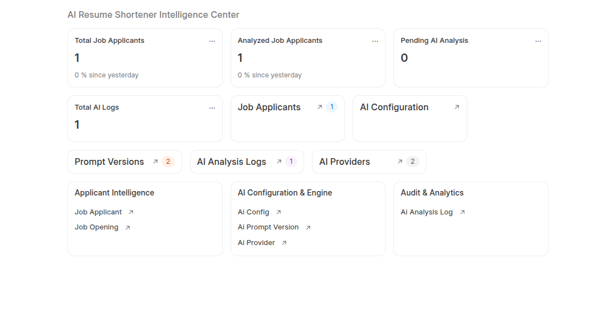
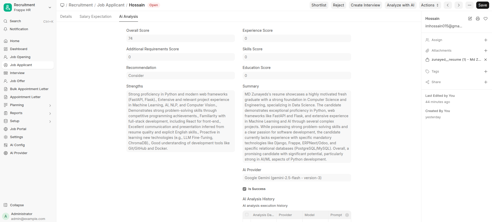
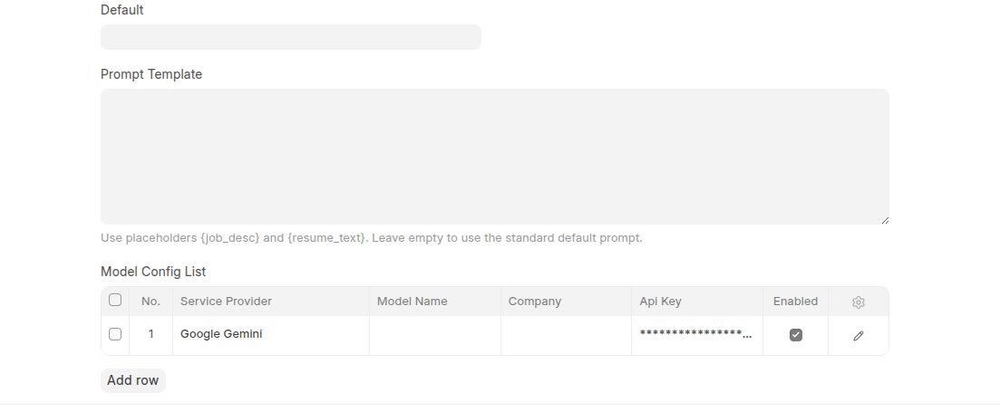
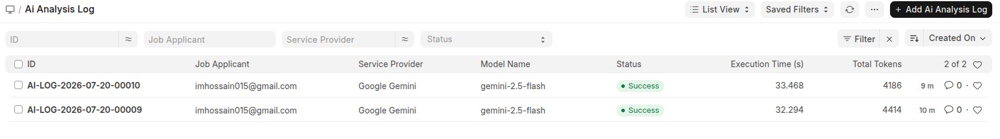

# AI Resume Shortener & Recruitment Intelligence Platform

**AI Resume Shortener** is an enterprise-grade recruitment intelligence and resume optimization app for **Frappe HR / ERPNext**. Automate candidate resume screening, ATS scoring, and interview question generation for Frappe HR with multi-model AI failover and token cost tracking across **Google Gemini**, **OpenRouter**, **OpenAI**, and **Claude**.

> 📖 **Full Documentation Portal**: Explore the interactive [Product Overview](https://invento-software-limited.github.io/ai_resume_shortener/), read the detailed [User Guide](docs/user_guide.md), or check out the [Product Architecture Overview](docs/product_overview.md).

---

## Key Features

### 1. Multi-Model AI Orchestration & Failover
- **Dynamic AI Models**: Configure and prioritize multiple AI models in the `Ai Model Config List` child table without hardcoded model names.
- **Multi-Provider Support**: Built-in support for **Google Gemini** (`gemini-2.5-flash`, `gemini-2.0-flash`) and **OpenRouter** (`gpt-4o-mini`, `claude-3-haiku`, etc.).
- **Automatic Failover**: If the primary AI provider fails or times out, the system automatically falls back to secondary enabled providers.
- **Cost & Token Tracking**: Calculates exact input/output token usage and estimated USD cost per resume evaluation.

### 2. Candidate Evaluation & ATS Matching
- **Job Description Alignment**: Matches resume contents against standard Job Description requirements.
- **Structured Metrics**:
  - Overall Fit Score (0–100)
  - Match Percentage (0–100%)
  - Confidence Score (0–100%)
  - Category breakdown: Education, Experience, and Skills scores
- **Candidate Star Rating**: Automatically sets Frappe HR candidate rating (1 to 5 stars) based on recommendation level and overall fit score.
- **Generated Insights**: Extracted skills, missing skills, candidate strengths, summary, and auto-generated interview questions (Technical, HR, and Behavioral).

### 3. Enterprise Prompt Management & Versioning
- **`Ai Prompt Version` DocType**: Manage versioned prompt templates (`v1.0-default`, `v2.0-custom`) with one-click activation and rollback.
- **Audit Traceability**: Every evaluation logs the exact prompt version, AI model, and provider used.

### 4. Background Processing & Queue Locks
- **Asynchronous Execution**: Per-applicant background jobs enqueued via `frappe.enqueue()` on queue `"default"`.
- **Non-blocking Hourly Scheduler**: Automatically picks up unanalyzed applicants without clogging server resources.
- **Queue Lock Protection**: Built-in deduplication safeguards prevent accidental double-enqueuing or duplicate API executions.

### 5. Auditability & Analysis History
- **`Ai Analysis Log`**: Centralized audit repository recording job status (`Queued`, `Success`, `Failed`, `Retried`), execution time (seconds), token counts, costs, error logs, and raw JSON payloads.
- **`Job Applicant AI History`**: Embedded child table on `Job Applicant` keeping a complete record of historical evaluations over time.
- **SHA256 Resume Hash**: Detects duplicate CV submissions across applicants.

### 6. Modern Desk Workspace
- **Intelligence Center Workspace**: Interactive workspace featuring Number Cards (*Total Applicants*, *Analyzed*, *Pending*, *Total Logs*), Shortcuts, and Card Breaks.
- **Instant Desk Actions**:
  - **Analyze with AI**: Instant synchronous evaluation with UI progress overlay.
  - **Enqueue Background Job**: Asynchronous background worker enqueuing.
  - **Benchmark Models**: Runs side-by-side comparative evaluations across all enabled AI models.

---

## Screenshots

### Intelligence Center Workspace


### Candidate AI Evaluation & ATS Scoring


### AI Model & API Key Configuration


### Centralized Audit & Execution Logs



---

## Installation

Install the app using the [bench](https://github.com/frappe/bench) CLI:

```bash
cd $PATH_TO_YOUR_BENCH
bench get-app https://github.com/invento-software-limited/ai_resume_shortener.git --branch main
bench --site <your-site-name> install-app ai_resume_shortener
bench --site <your-site-name> migrate
```

---

## Configuration

1. Navigate to **AI Resume Shortener ➔ AI Configuration**.
2. Open **Ai Provider** and set your API keys:
   - **Google Gemini**: Set API Key for Google AI Studio.
   - **OpenRouter**: Set API Key for OpenRouter API.
3. Open **Ai Model Config List** to enable your preferred models and set token pricing (per 1M tokens).
4. Select the default AI model in **Ai Config**.

---

## Verification & Usage

1. Open any **Job Applicant** document with a resume attachment (`.pdf`, `.docx`, `.txt`) or link.
2. Click **Analyze with AI** for instant evaluation, or select **Actions ➔ Enqueue Background Job** for background processing.
3. Review candidate scores, ratings, missing skills, generated interview questions, and historical evaluations.
4. Check **Ai Analysis Log** to monitor execution times, token consumption, and API costs.

---

## Support & Community

For technical support, custom feature requests, or enterprise consulting:
- **Website**: [https://invento.com.bd](https://invento.com.bd)
- **Email**: [hello@invento.com.bd](mailto:hello@invento.com.bd)
- **Issues**: [GitHub Issue Tracker](https://github.com/invento-software-limited/ai_resume_shortener/issues)

---

## License

[MIT License](LICENSE) &copy; 2026 Invento Software Limited.
