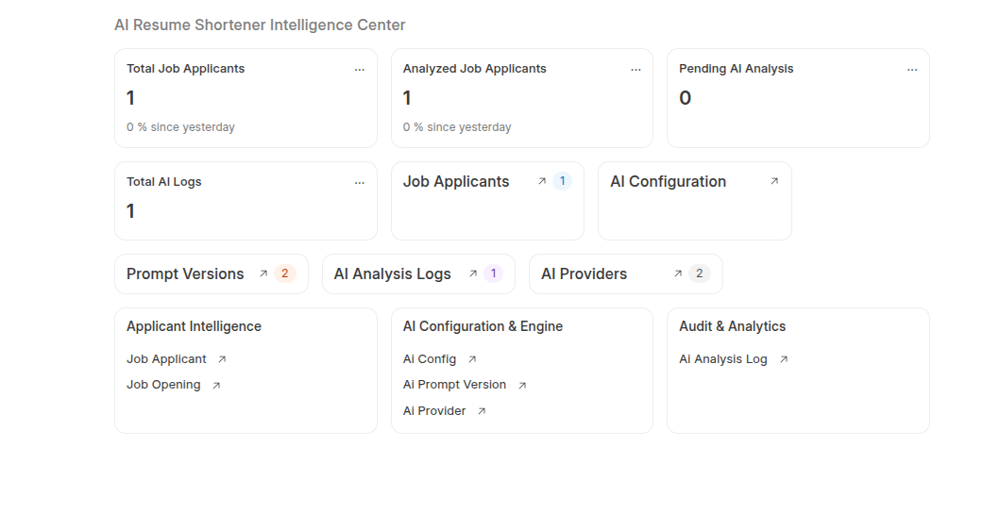
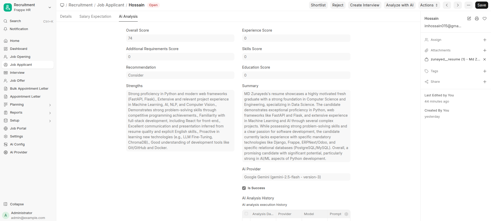
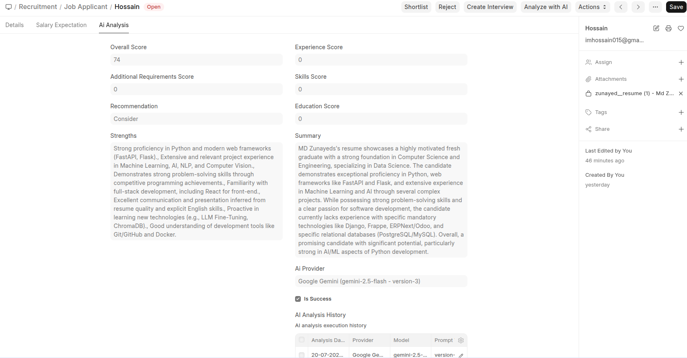
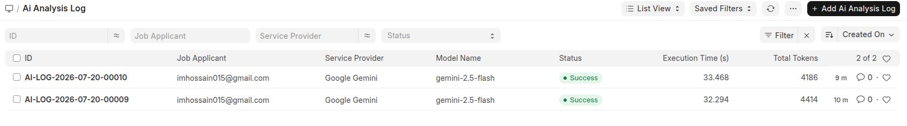

# AI Resume Shortener & Recruitment Intelligence Platform

**AI Resume Shortener** is an enterprise-grade recruitment intelligence and resume evaluation app for [Frappe HR](https://frappehr.com) and [ERPNext](https://erpnext.com). Automate candidate resume screening, ATS scoring, and interview question generation for Frappe HR with multi-model AI failover and token cost tracking across **Google Gemini**, **OpenRouter**, **Claude**, and **OpenAI**.

For setup instructions and usage details, refer to the [User Guide](user_guide.md).

---

## Target Audience

- **HR Managers & Recruiters**: Streamline candidate shortlisting by processing hundreds of CVs in seconds with structured ATS matching scores.
- **Talent Acquisition Leads**: Evaluate candidate technical strengths, missing skills, and auto-generated interview questions before conducting interviews.
- **Hiring Managers**: Compare candidates side-by-side using unified star ratings (1 to 5 stars) and detailed candidate summaries.
- **System Administrators & Consultants**: Dynamically configure AI providers, model fallback policies, prompt templates, and monitor API execution costs.

---

## Key Features

### 🎯 Multi-Model AI Orchestration & Cost Management
Configure multiple AI models (e.g. `gemini-2.5-flash`, `gpt-4o-mini`, `claude-3-haiku`) in the `Ai Model Config List`. If the primary model fails or times out, the system automatically falls back to secondary providers while calculating exact token usage and USD execution costs per candidate evaluation.

### 💾 ATS Match Scoring & Candidate Rating
- Calculates Fit Score (0–100), Match %, Confidence Score, Education, Experience, and Skills breakdowns.
- Automatically maps evaluation outcomes to Frappe HR Candidate Star Ratings (1 to 5 stars).
- Identifies extracted skills, matched skills, missing skills, and candidate strengths.

### 🔌 Enterprise Prompt Management & Versioning
Manage versioned prompt templates (`v1.0-default`, `v2.0-custom`) in **Ai Prompt Version** with one-click activation and rollback. Every evaluation records the prompt version and AI model used for complete auditability.

### ⚡ Async Background Enqueuing & Deduplication
- Asynchronous execution enqueued via `frappe.enqueue()` on queue `"default"`.
- Built-in deduplication queue locks prevent duplicate background jobs or accidental double API calls.
- Automated hourly background scheduler to process unanalyzed candidate resumes.

### 📊 Desk Workspace & Quick Action Tools
- Integrated **AI Resume Shortener Workspace** with real-time Number Cards (*Total Applicants*, *Analyzed*, *Pending*, *Total Logs*).
- Form action buttons on `Job Applicant`:
  - **Analyze with AI**: Synchronous instant evaluation.
  - **Enqueue Background Job**: Asynchronous background evaluation.
  - **Benchmark Models**: Side-by-side comparative model testing across all active AI providers.

---

## Visual Overview & Screenshots

### Intelligence Center Workspace

### Candidate Evaluation & ATS Scoring

### Candidate Evaluation Audit History

### Centralized Execution Audit Logs

---

## Technical Highlights

- Built for **Frappe v15 / v16**, **ERPNext**, and **Frappe HR (hrms)**.
- Per-applicant background queue isolation (`queue="default"`).
- SHA256 checksum hashing to detect duplicate resume uploads.
- Centralized audit tracking via `Ai Analysis Log` and `Job Applicant AI History` child table.
- Open source under the **MIT License**.

---

## About Invento Software Limited

Invento Software Limited creates high-performance enterprise applications and extensions for Frappe and ERPNext ecosystem.

- **Website:** [https://invento.com.bd](https://invento.com.bd)
- **Email:** [hello@invento.com.bd](mailto:hello@invento.com.bd)
- **GitHub:** [invento-software-limited](https://github.com/invento-software-limited)