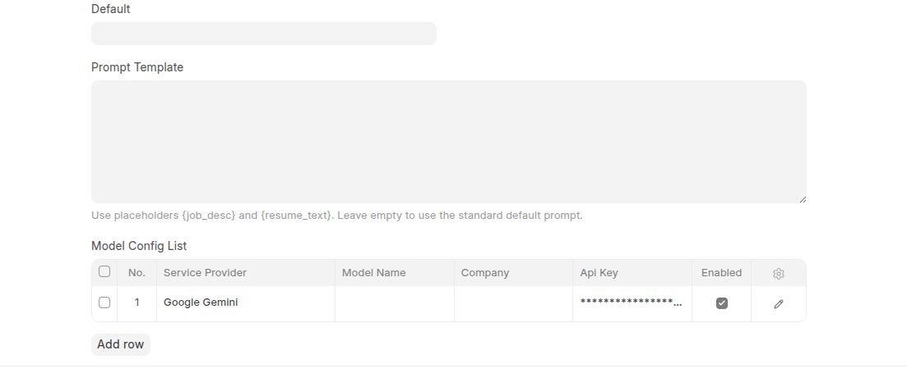
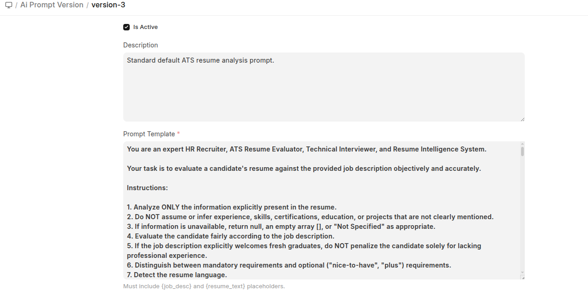
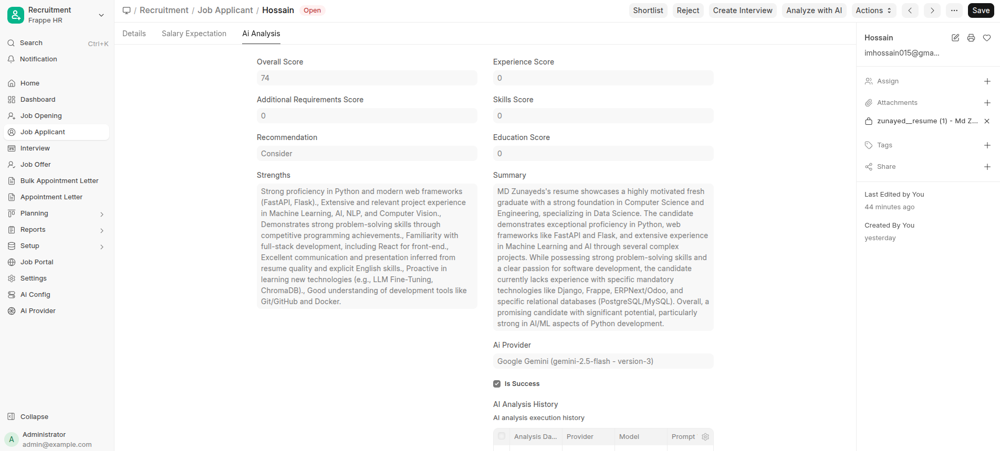
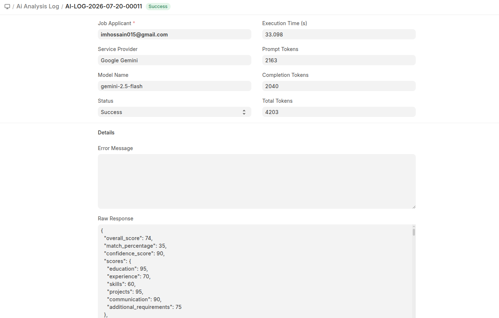
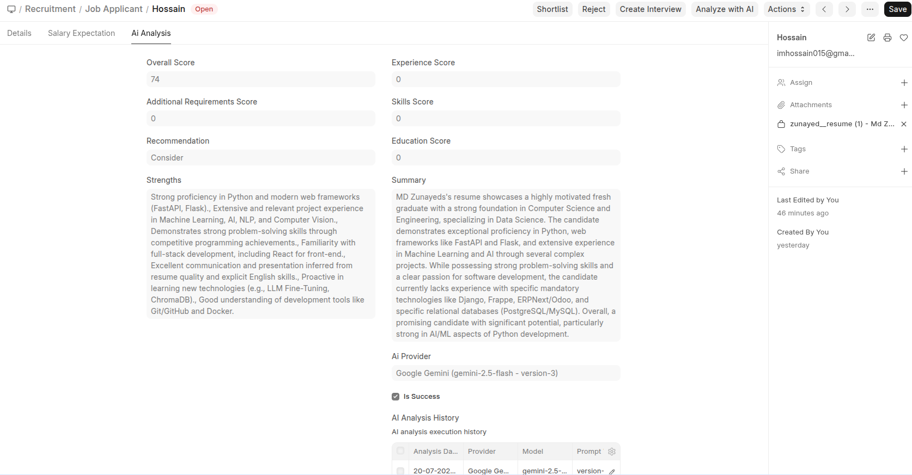

# AI Resume Shortener User Guide

Welcome to the official User Guide for **AI Resume Shortener** on [Frappe HR](https://frappehr.com) and ERPNext. For feature highlights and platform architecture, see the [Product Overview](product_overview.md).

## 🏁 Getting Started

### Prerequisites
- Frappe / ERPNext v15+ or v16+ instance.
- Frappe HR (`hrms`) app installed.
- Administrative privileges (`System Manager` or `HR Manager` role).
- An API Key from **Google AI Studio** (for Gemini) or **OpenRouter** (for multi-model access).

---

### 🚀 Installation

Install the app using the Bench CLI:

```bash
cd $PATH_TO_YOUR_BENCH
bench get-app https://github.com/invento-software-limited/ai_resume_shortener.git --branch main
bench --site your-site.com install-app ai_resume_shortener
bench --site your-site.com migrate
```

After migration, clear cache and restart the bench:

```bash
bench --site your-site.com clear-cache
bench restart
```

---

## ⚙️ Configuration

### 1. Setting Up AI API Credentials
1. Open **AI Resume Shortener ➔ Ai Provider** list.
2. Open **Google Gemini** or **OpenRouter**.
3. Input your **API Key** and save the document.

---

### 2. Configuring AI Models & Cost Matrix
1. Open **AI Configuration** doc or **Ai Model Config List**.
2. Enable your preferred AI models (e.g. `gemini-2.5-flash`, `gpt-4o-mini`).
3. Set input and output token pricing (per 1,000,000 tokens) to enable automatic USD execution cost tracking.



---

### 3. Managing Prompt Templates
1. Open **Ai Prompt Version**.
2. Review active template `v1.0-default` or create custom templates.
3. Check **Is Active** to activate a version globally across all candidate evaluations.




---

## 🎯 Usage Guide

### 1. Synchronous Instant Evaluation
1. Open any **Job Applicant** record with an attached CV (`.pdf`, `.docx`, `.txt`).
2. Click **Analyze with AI** at the top of the form.
3. The system processes the resume, calculates scores, sets the candidate **Applicant Rating** (1 to 5 stars), extracts missing skills, and auto-generates interview questions.



---

### 2. Background Queue Execution
1. On a **Job Applicant** record, select **Actions ➔ Enqueue Background Job**.
2. The evaluation is enqueued to the background worker (`queue="default"`).
3. Check the **Ai Analysis Log** list to track real-time queue execution states (`Queued` ➔ `Success`).

---

### 3. AI Model Benchmarking
1. On a **Job Applicant** record, select **Actions ➔ Benchmark Models**.
2. The benchmark engine runs the resume against all active AI providers simultaneously.
3. A modal table displays comparative metrics including latency (seconds), total tokens, estimated cost (USD), overall score, and recommendation.

---

## 🔍 Monitoring & Audit Logs

### 1. Ai Analysis Log
Go to **AI Resume Shortener ➔ Ai Analysis Log** to view execution history:
- **Status**: `Queued`, `Success`, `Failed`, or `Retried`.
- **Latency & Tokens**: Execution time in seconds, prompt tokens, completion tokens.
- **Raw Response**: Full JSON payload from the AI engine for audit verification.



### 2. Candidate Evaluation History
Scroll down on any **Job Applicant** record to view the **AI Analysis History** child table, showing historical evaluation scores across multiple prompt versions or model updates over time.




---

## 🛠️ Troubleshooting

### 1. "No Resume Attached" Warning
- Ensure the candidate record has an attachment (`.pdf`, `.docx`, `.txt`) in the standard attachment panel or attached file field.

### 2. Background Jobs Stuck in "Queued"
- Verify that the background worker is running:
  ```bash
  bench worker --queue default
  ```

### 3. Invalid API Key / Provider Errors
- Check **Ai Analysis Log** for failure error tracebacks.
- Verify API Key validity in **Ai Provider**.